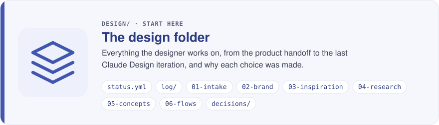

# design/

**Owner:** the design function (see `team.yml`). **Written by** the designer only, by pull request. The PM or lead is the backup.

This folder is the design record for the project. Anyone on the team should be able to open it and know what was designed, when, why, how long it took and what comes next, without asking the designer. Each folder below has its own README and a picture of what it holds.

## Start here

1. [`internal/status.yml`](internal/status.yml): where every design item stands today.
2. The newest file in [`internal/log/`](internal/log/): what happened on the last working day.
3. A flow's [`thinking.md` and `versions.md`](internal/06-flows/_flow-template/): why it looks the way it does.

## The map

The stage folders follow the order design work usually happens in. Work moves back and forth between them; the numbers only set the reading order.

| Folder | Holds |
| --- | --- |
| [`hub/`](hub/) | Nothing yet. The client sees design progress through the PM's weekly page. |
| [`internal/`](internal/) | The whole design record. Its top level holds the files the whole team reads: status, the list of design files, screens, approvals, change requests, open questions. |
| [`internal/01-intake/`](internal/01-intake/) | The product handoff and the constraints. |
| [`internal/02-brand/`](internal/02-brand/) | Brand guide, design system, its changelog and the thinking behind the direction. |
| [`internal/03-inspiration/`](internal/03-inspiration/) | Moodboards and references, as links, with why each was kept or dropped. |
| [`internal/04-research/`](internal/04-research/) | Personas, journeys and findings. |
| [`internal/05-concepts/`](internal/05-concepts/) | Wireframes and first drafts. |
| [`internal/06-flows/`](internal/06-flows/) | One folder per product flow built in Claude Design: brief, thinking, versions, states, copy, accessibility, feedback, prompts and the developer handoff. |
| [`internal/design-review/`](internal/design-review/) | After each release: what was built against what was designed. |
| [`internal/decisions/`](internal/decisions/) | One file per real design decision, with the reason and who approved it. |
| [`internal/log/`](internal/log/) | One file per working day. |
| [`internal/deltas/`](internal/deltas/) | Where design-versus-code difference notes live in the code repos. |

## Where the "why" lives

- `thinking.md` in `02-brand/` and in each flow: the design reasoning.
- `versions.md` in each flow: the reason for every iteration.
- `03-inspiration/` and `05-concepts/`: why a board, reference or concept was kept or dropped.
- `decisions/`: the big choices, the options and who approved them.
- `log/`: the reason behind each day's work.

## Keeping it up to date

At the end of a Claude Design session, ask the agent to wrap up. It drafts the day's `log/` entry, a new row in the flow's `versions.md`, any change to `thinking.md`, a file in `decisions/` when a real choice was made, and the update to `status.yml`, from what changed and what was said in the session. You check the draft, add any reason it could not know, and approve the pull request. The weekly run then reads `log/`, `status.yml`, `approvals.yml` and `change-requests.yml` to draft the design lines of the PM's weekly page.

## Rules

- **Links, not copies.** Designs stay in Claude Design; this folder holds the link, the version and the reasoning. Exports, screenshots and other binary files are not stored (the `cover.svg` pictures that explain each folder are the only images).
- **Internal by default.** Nothing here reaches the client. Sharing a design with the client is the PM's decision.
- **One writer.** Only the designer, or the PM or lead as backup, changes this folder.
- **Time stays internal.** Hours in the log are for the team. The PM may roll them up into a role-level total on the Hours page; rates never enter the repo.
- **No restricted material.** No credentials, commercial terms or personal details.

## Repos made before this layout

Earlier repos have `internal/briefs/`, `internal/prototypes/`, `internal/handoff/` and `internal/figma.yml`. Move a brief to `06-flows/<flow>/brief.md`, a prototype spec to that flow's `versions.md` and `prompts.md`, a handoff spec to `dev-handoff.md`, and the rows of `figma.yml` to `design-files.yml`. Copy the new folders from `playbook/templates/delivery-repo/design/`. `validate` only notes missing Stage 2 folders, so the move can wait for a quiet week.
