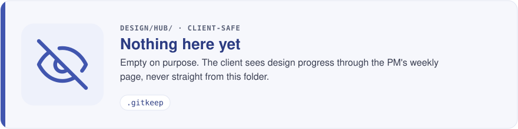

# design/hub/

**Client-safe tier.** Empty on purpose: nothing on the Delivery Hub comes from design yet. The folder exists because every function folder has a `hub/`, and validation expects it.

The client sees design progress through the PM's weekly page ("Last week": shipped, decided, next, waiting on the client). The agent drafts those lines from `internal/log/` and `internal/status.yml`, and the PM approves the wording before anything is published.

**Do not add files here** unless a Delivery Hub section is built that reads them. Sharing a design itself with the client (a Claude Design link) is a PM decision, recorded in `internal/approvals.yml` or `internal/decisions/`.

Keep the `.gitkeep` file.
