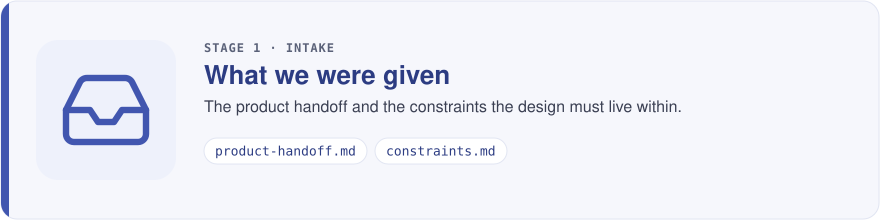

# design/internal/01-intake/

**Written by** the designer (the PM or lead as backup), by pull request through `scripts/sync.py`. **Visibility** internal: never rendered on the Delivery Hub.

What the design team received before any design started, and the limits the design must work within. Write it once at the start and update it when the product changes.

| File | Holds |
| --- | --- |
| [`product-handoff.md`](product-handoff.md) | What we received, from whom and when; what the product is, who it is for and what we were asked to design |
| [`constraints.md`](constraints.md) | Platforms, devices, deadlines, technical limits, accessibility level and must-haves |

Link to the source (a requirement in `product/internal/requirements/`, a meeting summary, a document) rather than pasting it. Anything still unclear goes in `../open-questions.yml`.
