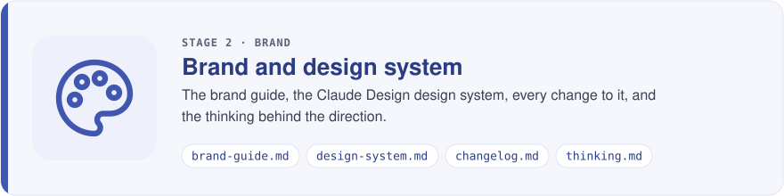

# design/internal/02-brand/

**Written by** the designer (the PM or lead as backup), by pull request through `scripts/sync.py`. **Visibility** internal: never rendered on the Delivery Hub.

The brand and the design system everything else is built from.

| File | Holds |
| --- | --- |
| [`brand-guide.md`](brand-guide.md) | Logo, colour, type, imagery and voice: the link to the guide and a short summary |
| [`design-system.md`](design-system.md) | The Claude Design design system: link, current version, what it contains |
| [`changelog.md`](changelog.md) | Every change to tokens or components, with the reason and the date |
| [`thinking.md`](thinking.md) | Why this brand direction: the options explored and why this one was chosen |

The design system is also a row in `../design-files.yml` (kind `design-system`). Tokens go into the code repo; this folder keeps the link, the version and the reasons. When a token or component changes, add a line to `changelog.md` in the same pull request.
