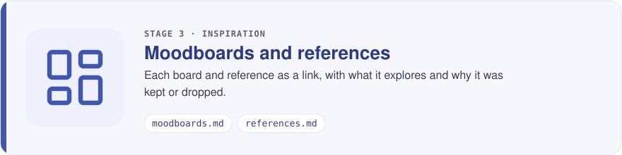

# design/internal/03-inspiration/

**Written by** the designer (the PM or lead as backup), by pull request through `scripts/sync.py`. **Visibility** internal: never rendered on the Delivery Hub.

Moodboards and references, kept as links with the reasoning. The images themselves stay in Claude Design or on the drive.

| File | Holds |
| --- | --- |
| [`moodboards.md`](moodboards.md) | Each board: link, the mood it explores, kept or dropped, and why |
| [`references.md`](references.md) | Each reference product or screen: what we take from it, and why |

Record rejected boards too: knowing why a direction was dropped saves the next designer from trying it again.
