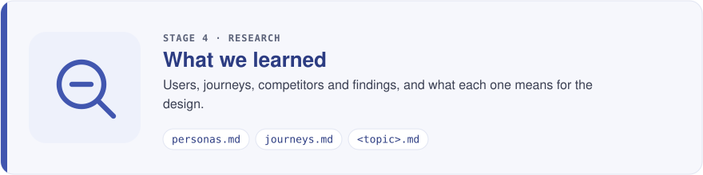

# design/internal/04-research/

**Written by** the designer (the PM or lead as backup), by pull request through `scripts/sync.py`. **Visibility** internal: never rendered on the Delivery Hub.

Who the users are, the paths they take, and what research found. Every "why" in a flow's `thinking.md` can point back here.

| File | Holds |
| --- | --- |
| [`personas.md`](personas.md) | The main users: goals, frustrations, context |
| [`journeys.md`](journeys.md) | The paths users take, step by step, with pain points |
| `<topic>.md` | One file per piece of research (a competitor review, interview findings, an analytics look), from [`_template.md`](_template.md) |

Summarise findings; do not paste transcripts or raw data. Interview notes with personal details stay out of the repo.
