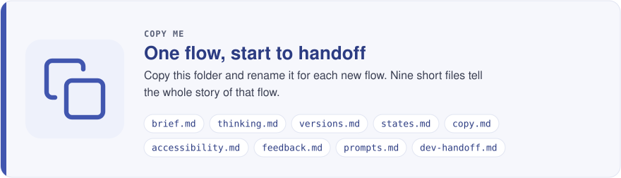

# design/internal/06-flows/_flow-template/

Copy this folder, rename it with the flow id, and delete this README from the copy (or rewrite it as a one-line description of the flow). Leave the template itself in place.

Read the files in this order to understand a flow: `brief.md`, `thinking.md`, `versions.md`. The rest support review and handoff. What each file holds is listed in [`../README.md`](../README.md).
