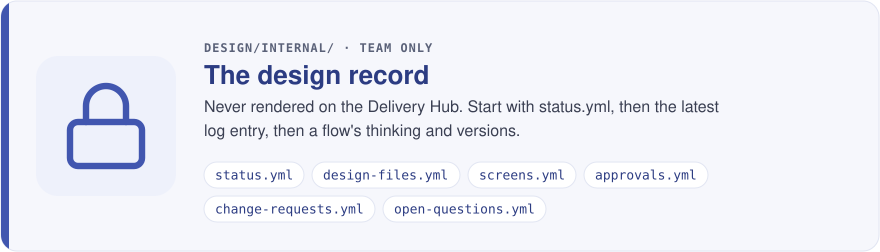

# design/internal/

**Written by** the designer (the PM or lead as backup), by pull request through `scripts/sync.py`. **Visibility** internal: never rendered on the Delivery Hub.

Everything the design team produces and decides, in one place the whole team can read.

## Files at this level

These are the files most people need. Each one is a list, so a report or a new team member can read it in a minute.

| File | Holds | Read by |
| --- | --- | --- |
| [`status.yml`](status.yml) | Where every design item stands today: stage, status, version, next step, what it is waiting on, hours so far | Everyone; the weekly run |
| [`design-files.yml`](design-files.yml) | Every Claude Design link (brand, boards, concepts, flows, the design system) with the version that matters | Everyone |
| [`screens.yml`](screens.yml) | Every screen and state, which flow it belongs to and its status | Devs, QA |
| [`approvals.yml`](approvals.yml) | What the client or product signed off, which version, when, and the proof | PM, product |
| [`change-requests.yml`](change-requests.yml) | Changes asked for after something was approved, flagged to the PM as possible scope | PM |
| [`open-questions.yml`](open-questions.yml) | What is waiting on the client, product or devs | Everyone |
| [`assets.md`](assets.md) | Fonts, icons, illustrations and images: where each came from and its licence | Devs, PM |
| [`naming.md`](naming.md) | Component and token names, matched to the code | Devs |
| [`prompt-library.md`](prompt-library.md) | Claude Design instructions that worked well, for any designer to reuse | Designers |
| [`learnings.md`](learnings.md) | What worked and what to do differently next time | Designers, PMO |

## Folders

The stage folders `01-intake/` to `06-flows/`, then `design-review/`, `decisions/`, `log/` and `deltas/`. Each has its own README.

## Conventions

- Ids are short, lowercase and hyphenated (`checkout`, `guest-checkout`), and the same id is used everywhere: the flow folder, `status.yml`, `screens.yml`, `design-files.yml` and the log.
- Dates are `YYYY-MM-DD`.
- Visibility is `internal` unless the PM has decided a design may be shared with the client; then it is `client-visible`.
- A file that starts with `_` is a template. Copy it, rename it and fill it in; leave the template in place.
