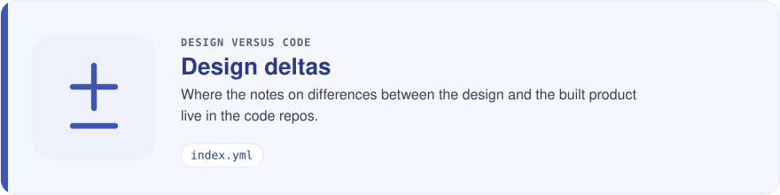

# design/internal/deltas/

**Written by** the designer (the PM or lead as backup), by pull request through `scripts/sync.py`. **Visibility** internal: never rendered on the Delivery Hub.

Where the notes on differences between the design and the built product live in the code repos. The notes stay in the code repos; [`index.yml`](index.yml) lists their locations (a manifest, kind `architecture`), so the team can find them all from one place.

Design reviews in `../design-review/` add rows here when a difference needs a fix.
