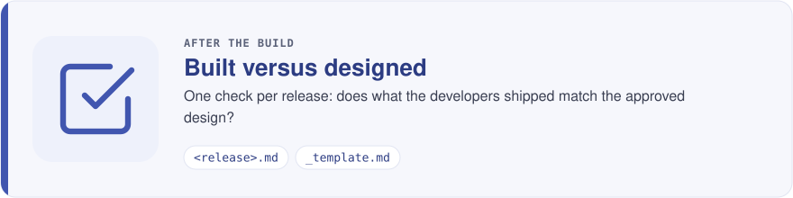

# design/internal/design-review/

**Written by** the designer (the PM or lead as backup), by pull request through `scripts/sync.py`. **Visibility** internal: never rendered on the Delivery Hub.

After each release, the designer checks what was built against the approved design. One file per release, copied from [`_template.md`](_template.md) and named after the release (`v1.2.md`).

Differences the team accepts are noted here. Differences that need a fix become tickets in the code repo; their locations are listed in `../deltas/index.yml`.
