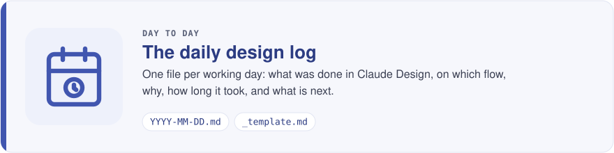

# design/internal/log/

**Written by** the designer (the PM or lead as backup), by pull request through `scripts/sync.py`. **Visibility** internal: never rendered on the Delivery Hub.

One file per working day, named `YYYY-MM-DD.md` from [`_template.md`](_template.md). It records what was done in Claude Design, on which flow, why, how long it took and what comes next. A report for any day or week is built from these files.

At the end of a session, ask the agent to wrap up: it drafts the entry from what changed in Claude Design and what was said in the session, and you fill in any reason or time it could not know.

Hours are internal and approximate. They add up to `hours_to_date` in `../status.yml`. The PM may roll them up into a role-level total on the Hours page; per-person hours and rates never reach the client.
